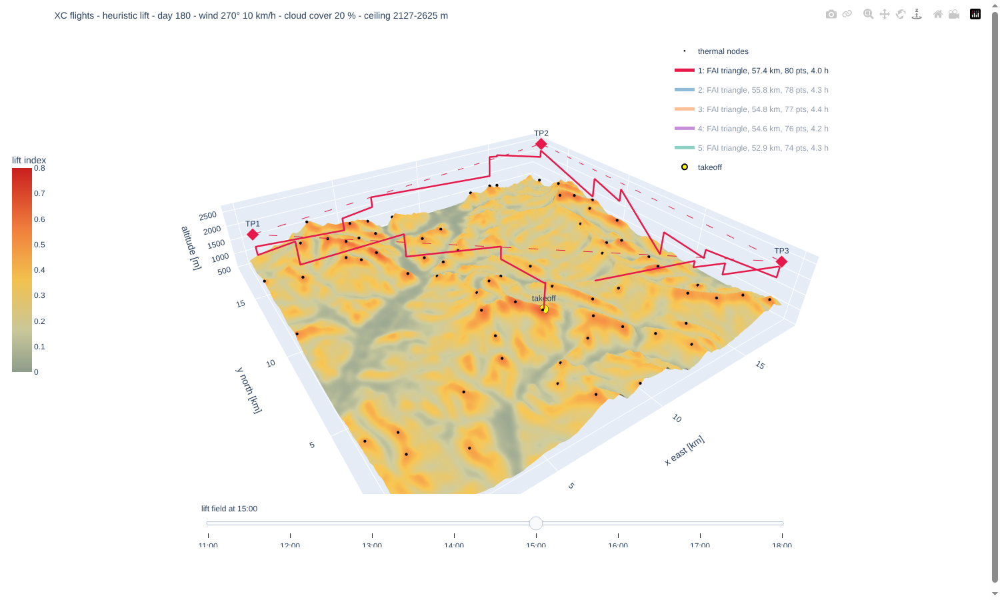
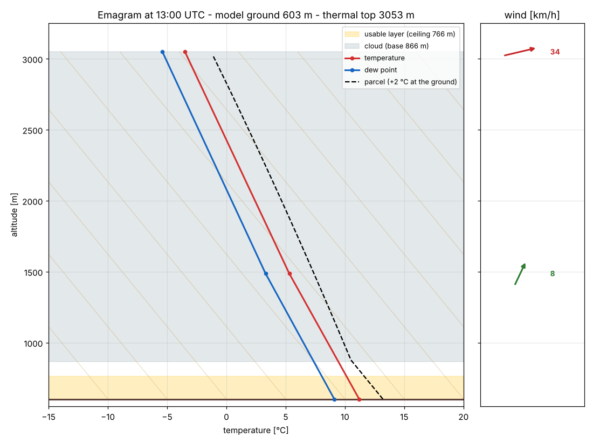
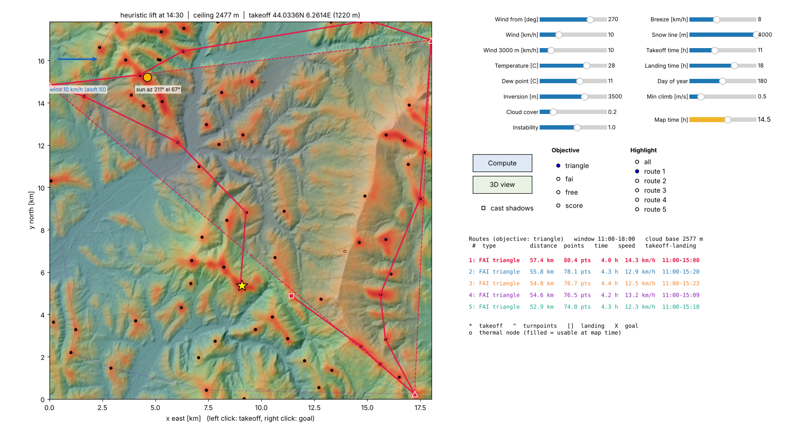

# cheminee

**Paragliding cross-country flight planner.** From a digital elevation model (DEM) and the weather of the day,
cheminee finds the flights a pilot could make from a takeoff: free distance, flat and FAI triangles, or a flight
to a goal, with the speed to fly on every glide.

- a **weather model** of the day: wind profile, cloud base, cloud cover, instability, breezes, snow line, cast
  shadows, hourly evolution, and AROME forecasts through Open-Meteo with an emagram;
- a **thermal model**, analytical or **learnt from IGC tracks** (neural network), by hour and day of year;
- a **route optimiser**: MacCready speed to fly from the glider polar, free distance via 3 turnpoints, flat and
  FAI triangles scored with the French CFD rules, flight to a goal;
- a 2D interface, an interactive **3D scene**, and an **export** to the flight package read by the
  [vautour](#related-project-vautour) navigation app.



> **Project status.** The whole pipeline works and is tested, but the network shipped in
> `models/thermal_net.pt` was trained on **synthetic tracks** generated by the repository itself. It validates
> the pipeline; it does not predict real thermals. Physical coefficients (polar, weather factors) are sensible
> orders of magnitude, not calibrated on real flights. **Never use the output to decide whether, or where, to
> fly.**

## Quick start

Python 3.10 or later.

```bash
python -m venv .venv && source .venv/bin/activate
pip install -e ".[dev]"
tar -xzf data/rasters_COP30_sample.tar.gz -C data/     # sample DEM -> data/output_hh.asc
pytest                                                 # 58 tests, about 15 s
cheminee serve data/output_hh.asc --open               # web interface (3D map) on http://127.0.0.1:8765
cheminee gui data/output_hh.asc                        # 2D interface
```

Dependencies: numpy, scipy, matplotlib, pillow, plotly, torch (CPU is enough). To avoid the large CUDA build of
torch on Linux: `pip install torch --index-url https://download.pytorch.org/whl/cpu` before the line above.

## Commands

| Command | What it does |
|---|---|
| `cheminee serve DEM` | local web interface: 3D map, takeoff by click, weather and forecast, flights |
| `cheminee gui DEM` | 2D interface: weather sliders, routes, lift map by hour |
| `cheminee plan DEM` | compute flights and print them as text |
| `cheminee view3d DEM --out flights.html` | standalone interactive 3D scene (opens in a browser) |
| `cheminee export DEM --out flight.json` | flight package for the vautour app ([format](docs/flight-package.md)) |
| `cheminee weather DEM` | show (and save with `--out`) the resolved weather, hour by hour |
| `cheminee sounding DEM --date … --forecast` | analyse the model sounding of the day and draw its emagram |
| `cheminee fetch-weather IGC_DIR` | download the archived weather of every IGC flight of a directory |
| `cheminee synth-igc DEM` | generate synthetic IGC tracks (pipeline testing) |
| `cheminee train DEM IGC_DIR` | train the thermal network |

`cheminee <command> --help` lists every option. Common examples:

```bash
DEM=data/output_hh.asc

cheminee gui $DEM --model models/thermal_net.pt      # with the neural lift model
cheminee plan $DEM --weather strong_unstable         # weather preset
cheminee plan $DEM --objective fai                   # FAI triangles only
cheminee plan $DEM --goal 6.19 44.12                 # fastest route to a goal (lon lat)
cheminee plan $DEM --takeoff 6.25 44.10 --t-start 11 --t-end 18
```

### Weather

Three ways to set it, combined in this order: a preset or a file, then a forecast, then explicit values.

```bash
cheminee plan $DEM --weather north_wind                        # preset
cheminee plan $DEM --weather my_weather.json                   # JSON file
cheminee plan $DEM --date 2026-06-29 --forecast                # Open-Meteo forecast of the day (needs network)
cheminee plan $DEM --wind-dir 200 --wind-speed 15 --wind-aloft-speed 30 --cloud-cover 0.4 --temp 26 --dewpoint 9
cheminee weather $DEM --weather blue_stable --out my_weather.json
```

Presets: `good_day`, `blue_stable`, `strong_unstable`, `north_wind`, `overcast`, `spring_snow`.

| Parameter (`Weather`) | Option | Effect |
|---|---|---|
| `wind_dir_deg`, `wind_speed_kmh` | `--wind-dir`, `--wind-speed` | low-level wind: windward / lee faces, drift |
| `wind_aloft_dir_deg`, `wind_aloft_speed_kmh` | `--wind-aloft-dir`, `--wind-aloft-speed` | wind at 3000 m; interpolated with altitude, used on glides |
| `temp_c`, `dewpoint_c`, `station_alt_m` | `--temp`, `--dewpoint`, `--station-alt` | cloud base = station + 125 m per °C of spread, rising during the day |
| `inversion_alt_m` | `--inversion` | top of the convective layer: caps the climbs |
| `cloud_cover` | `--cloud-cover` | reduces sunshine on the ground |
| `thermal_strength` | `--strength` | instability: multiplies the lift index |
| `breeze_kmh` | `--breeze` | slope / valley breeze, strongest in the afternoon |
| `snow_line_m` | `--snow-line` | above it, snow-covered ground: almost no thermals |
| `cast_shadows` | `--shadows` | shadows cast by the terrain (slower) |
| `overdev_hour` | `--overdev` | solar hour of overdevelopment: end of flying |
| `hourly` | JSON file / `--forecast` | hourly series that replace the scalar values |

### AROME forecast and emagram

`--forecast` queries Open-Meteo with the Météo-France models (`meteofrance_seamless`: AROME where it exists,
ARPEGE elsewhere; another model with `--forecast-model`). The request asks for the vertical profile
(temperature, dew point, wind, geopotential height) on 11 pressure levels from 950 to 500 hPa. From it the code
derives the hourly **ceiling** (parcel method, see [docs/model.md](docs/model.md)), the **instability** and the
**wind** at every altitude.

```bash
cheminee sounding $DEM --date 2026-11-15 --forecast --save-json forecast.json --out emagram.png
cheminee plan $DEM --date 2026-11-15 --utc-offset 1 --forecast-json forecast.json   # replay offline
```



This emagram comes from a real API answer for Digne-les-Bains on 15 November 2026 (kept in `tests/data/`, with
only two pressure levels): cloud base around 900 m, so no cross-country flight that day. Without Internet access,
open the URL printed by the command in a browser, save the answer and pass it with `--forecast-json`.

### Route kinds

| `--objective` | Route | Coefficient |
|---|---|---|
| `triangle` (default) | triangle through 3 turnpoints, closed within 5 % of the perimeter | 1.2 flat, 1.4 FAI |
| `fai` | triangle whose shortest side is at least 28 % of the perimeter | 1.4 |
| `free` | free distance via 3 turnpoints (open, 4 legs) | 1.0 |
| `score` | the three kinds ranked together by points | |

### Web interface

`cheminee serve DEM [--model CKPT] [--port 8765] [--open] [--no-forecast]` starts a local server (bound to
127.0.0.1) and prints its address. In the browser:

1. **Takeoff**: click on the map, inside the computed area (dashed outline). Right-drag or Ctrl-drag tilts and
   rotates the 3D view, scroll zooms. Without a click, the planner chooses.
2. **Day**: date (sets the day of year, needed by the forecast), takeoff and landing times.
3. **Weather**: a preset, optionally the Open-Meteo forecast of the date at the takeoff, and any value forced by
   hand. **Preview the weather** shows ceiling, cloud base, wind and sunshine hour by hour.
4. **Flights**: objective and number of routes, then **Compute flights**. The planner log is shown while it
   runs. Routes are drawn in 3D at their flight altitude: climbs in thermals as columns, glides as descending
   ribbons, with a translucent curtain down to the ground; turnpoints and thermal nodes are drawn on the ground.
   Click a route to show or hide it,
   **profile & segments** shows its altitude profile (flight, ground, ceiling) and lists its climbs and glides.
   The toolbar overlays the lift index of any hour, switches the background map and sets the relief.

The map is [MapLibre GL JS](https://maplibre.org) 4.7.1 (BSD-3, vendored in `src/cheminee/web/static/vendor/`,
no CDN). The 3D relief comes from elevation tiles the server cuts on the fly from **the same DEM as the
planner** (`web/tiles.py`), so what you see is what is computed; outside the DEM the relief slopes down to a flat
floor and the map is darkened. The background map (OpenTopoMap or OpenStreetMap tiles) is the only part loaded
from the network: choose **none (offline)** to work without network, with the relief and hillshade only. The
Open-Meteo forecast also needs the network (`--no-forecast` disables it). Standard library server, no new Python
dependency.

Speed: the page weighs 235 kB gzipped (MapLibre included); map and relief tiles load with the zoom; the hourly
lift fields are computed in parallel and kept for the weather and day in use, so trying another takeoff or
objective only reruns the route search (about 0.5 s instead of 1.4 s on the sample DEM); an identical request is
answered from memory. Responses are gzipped and cached by the browser, and the page follows a computation by long
polling.

### 2D interface

Left click: move the takeoff. Right click: set a goal (fastest route). Weather and time sliders, then
**Compute**. **Map time [h]** scrolls the lift field through the day. **3D view** exports the 3D scene of the
current result and opens it in the browser.



### Training on IGC tracks

```bash
cheminee fetch-weather path/to/igc        # one Open-Meteo archive request per flight -> flight.weather.json
cheminee train $DEM path/to/igc --report docs/img/training_report.png
```

Each `flight.igc` can come with a `flight.weather.json` (a serialised `Weather`). Météo-France archives at
Open-Meteo start in September 2022. Without a weather file, the weather of the flight is estimated from the
track: wind from the drift of the thermals, ceiling from the highest altitude, the rest left at defaults (the
network then learns nothing about cloud cover or instability).

Without real tracks, the pipeline runs on synthetic ones:

```bash
cheminee synth-igc $DEM --out data/igc_synthetic -n 300
cheminee train $DEM data/igc_synthetic --report docs/img/training_report.png
python scripts/synthetic_benchmark.py $DEM models/thermal_net.pt
```

IGC files are personal data: only train on tracks whose pilots agreed, and do not commit them (`data/` is
ignored by git, except the sample DEM).

## Related project: vautour

**vautour** is the phone app of the project: a Waze-like navigation screen that guides the pilot along the
routes computed here (manoeuvre banner, speed to fly, vario, hazard reports). The two repositories only share
the **flight package**, a versioned JSON contract defined by
[`schema/flight-package.v1.schema.json`](schema/flight-package.v1.schema.json) and documented in
[docs/flight-package.md](docs/flight-package.md).

## Repository layout

```
src/cheminee/
├── config.py            parameters of a request (day, weather, polar, margins, search, scoring)
├── domain/              dependency-free core: terrain, sun, polar, route, 3-point scoring
├── weather/
│   ├── model.py           Weather + presets (PRESETS)
│   ├── sounding.py        vertical profile: parcel, cloud base, ceiling, wind by level
│   └── openmeteo.py       Open-Meteo request and conversion to Sounding / Weather
├── lift/                lift models behind one interface
│   ├── base.py            LiftModel protocol: field(hour) -> grid in [0, 1]
│   ├── heuristic.py       analytical model (sun x slope x relief x wind x weather)
│   ├── features.py        network inputs (shared by training and inference)
│   └── neural.py          ThermalNet (PyTorch MLP) + NeuralLift
├── igc/                 IGC read/write, thermal detection, wind, synthetic generator
├── training/            dataset construction and training loop
├── planning/
│   ├── planner.py         thermal nodes, hourly graph, speed to fly, free distance
│   └── optimizer.py       fastest paths, triangles, goal, overall objective
├── export/              flight package for the vautour app (flight_package.py)
├── viz/                 matplotlib GUI (gui.py), plotly 3D scene (scene3d.py), emagram (emagram.py)
├── web/                 local web interface: JSON API (server.py), DEM tiles (tiles.py), MapLibre page (static/)
└── cli.py               `cheminee` entry point (composition root)
schema/                  flight-package.v1.schema.json, the contract with vautour
tests/                   pytest suite on an analytical terrain + a real Open-Meteo answer
scripts/                 synthetic_benchmark.py, plot_speed_to_fly.py
docs/                    model.md, architecture.md, flight-package.md, figures
models/                  thermal_net.pt (trained on synthetic tracks)
data/                    sample DEM; IGC files are not versioned
```

## Documentation

- [docs/model.md](docs/model.md): notation, weather, thermals, network, planner, optimiser, results.
- [docs/architecture.md](docs/architecture.md): layers, dependency rule, data flow, extension points.
- [docs/flight-package.md](docs/flight-package.md): the contract with vautour.
- [CONTRIBUTING.md](CONTRIBUTING.md): setup, checks, pull requests.
- [CLAUDE.md](CLAUDE.md): working notes for AI coding assistants (useful for humans too).

## Known limitations

- The shipped network is trained on synthetic data only; there is no validation on real flights.
- Open-Meteo conversion is tested on a real answer (two pressure levels). The full 11-level request, the archive
  host and `fetch-weather` have not been run against the live service yet: check them on first use.
- The vertical profile is taken at one point (takeoff or DEM centre) and applied to the whole area.
- The sample area is 18 × 18 km: routes are constrained by the edges of the DEM.
- Wind is horizontally uniform (vertical profile + slope breeze); no localised clouds or showers.
- Track selection bias: the air mass is only observed where pilots flew.
- Not modelled: airspace, landing fields, convergence lines, explicit ridge soaring.
- Only the ESRI ASCII grid format (`.asc`, WGS84) is read for the DEM.

## Disclaimer

Paragliding is dangerous. This software is an experimental prototype provided "as is", without any warranty,
as stated in the [licence](LICENSE). Its results (routes, thermals, weather, margins, reports) may be wrong. It
is not a flight instrument and must never replace your own judgement, official weather forecasts, airspace
information or flight instruments. You alone are responsible for your decisions; the authors and contributors
accept no liability for any damage, injury or loss arising from its use.

## Licence and data

Code: [MIT licence](LICENSE): free to use, copy, modify, distribute and sell, including commercially, as
long as the licence notice is kept.

Data shipped in the repository keeps its own licence:

- `data/rasters_COP30_sample.tar.gz` is an extract of the Copernicus DEM GLO-30. Any product made from it must
  carry the notice: *"produced using Copernicus WorldDEM-30 © DLR e.V. 2010-2014 and © Airbus Defence and Space
  GmbH 2014-2018 provided under COPERNICUS by the European Union and ESA; all rights reserved"*. `cheminee
  export` writes it into every flight package.
- Forecasts come from [Open-Meteo](https://open-meteo.com) (data under CC BY 4.0, from Météo-France models). The
  free API is for non-commercial use; credit Open-Meteo wherever its data is shown.

Co-authored by Claude (Anthropic).
