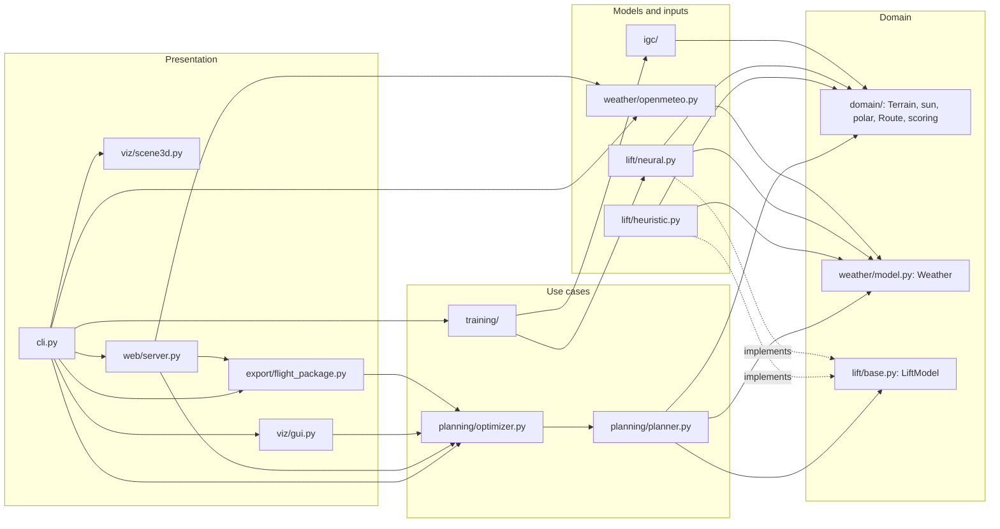

# Architecture

The repository follows a layered architecture where dependencies point towards the domain core.



## Layers

| Layer | Modules | Depends on | Content |
|---|---|---|---|
| Domain | `domain/`, `weather/model.py`, `weather/sounding.py`, `config.py`, `lift/base.py` | numpy, scipy | Terrain (local frame, shadows, breeze direction), sun, polar, `Route`, 3-point scoring, `Weather`, `LiftModel` protocol |
| Lift models | `lift/heuristic.py`, `lift/neural.py`, `lift/features.py` | domain (+ torch for `neural`) | Two implementations of `LiftModel` |
| Inputs | `igc/`, `weather/openmeteo.py` | domain | IGC files, thermals, estimated wind, synthetic generator; forecast → `Sounding` → `Weather` |
| Use cases | `planning/`, `training/` | domain, `LiftModel`, `igc/` | Node graph and route search, optimiser; dataset and training |
| Presentation | `viz/`, `export/`, `web/`, `cli.py` | everything else | matplotlib GUI, plotly 3D scene, emagram, flight package for the vautour app, local web interface, command line |

## Dependency rule

- `domain/` and `weather/model.py` import no other module of the package (except `config.py`, which assembles
  them).
- The planner only knows the `LiftModel` protocol (`field(hour_local) -> grid (ny, nx) in [0, 1]`) and the
  `Weather` object: it does not care whether lift comes from a formula or a network, nor whether the weather
  comes from a preset, a file or a forecast.
- Implementation choices are made in one place, `cli._flight_setup` / `cli.build_weather` / `cli.lift_factory`
  (composition root). `web.WebApp` receives its lift factory and forecast downloader from `cli.cmd_serve`.
- `torch` is only imported by `lift/neural.py` and `training/`; `plotly` only by `viz/scene3d.py`; the network
  (HTTP) only by `weather/openmeteo.fetch`. `web/` serves the plotly.js file of the plotly package from disk
  without importing plotly, and only listens on 127.0.0.1.
- `export/` turns planner results into the versioned JSON contract described in
  [flight-package.md](flight-package.md). It reads the planner and the optimiser, never the reverse.
- Accepted exception: `igc/synthetic.py` uses the planner to simulate flights. It is a testing tool, not a
  dependency of the real path (real IGC files → training).

## Data flow

```
IGC files ──read_igc──> IgcTrack ──detect_thermals──> thermals
   flight.weather.json (or estimate from the track) ──> Weather of the flight
      DEM ──Terrain──> static_stack ─┐
                                     ├─ assemble ──> X (n, 21) ─┐
          day, UTC hour, Weather ────┘                          ├─ train ──> models/thermal_net.pt
          vertical air speed ──> y in [0, 1] ───────────────────┘

preset / JSON / Open-Meteo ──> Weather ─┐
Params (day, polar, margins, objective) ┼─> Planner ──> nodes + hourly graph
Terrain + LiftModel ────────────────────┘        │
                              RouteOptimizer ────┴──> [Route] ──> gui / scene3d / text / flight package
```

## Extension points

**New lift model.** Write a class with a `name` attribute and a `field(hour_local) -> np.ndarray` method of
shape `(terrain.ny, terrain.nx)`, values in `[0, 1]` (the vertical air speed is `Params.w_ref_ms` × index). Plug
it in `cli._flight_setup`.

**New weather parameter.** Add it to `Weather` (`weather/model.py`), use it in `HeuristicLift` and, if the
network should see it, in `lift/features.py`. To expose it: one line in `cli.WEATHER_OPTIONS`, one in
`web/server.WEATHER_FIELDS` and one in `viz/gui.WEATHER_SLIDERS`. If it varies during the day, add it to `HOURLY_KEYS`.

**New forecast source.** Write a function returning a `Weather` (see `weather/openmeteo.py`: the pure conversion
`weather_from_payload` is kept apart from the network call `fetch`).

**New network input.** Change `lift/features.py` only. A checkpoint trained with another feature list is
refused at load time.

**New objective.** Add a method to `RouteOptimizer` that chains segments computed by `earliest()`, then calls
`Planner.make_route`, and dispatch it in `optimise()`.

**New field in the flight package.** See "Changing the format" in [flight-package.md](flight-package.md).

## Tests

`pytest` uses an analytical terrain (two ridges and a valley, `tests/conftest.py`): no external file is needed,
and no test touches the network.

| File | Covers |
|---|---|
| `test_domain.py` | sun geometry, coordinate conversions, 3-point scoring against an exhaustive search |
| `test_weather.py` | cloud base, wind profile, breeze, serialisation, polar, effect of each parameter on lift, cast shadows, Open-Meteo conversion, sounding analysis of a real API answer |
| `test_planner.py` | consistency of routes and profiles, closing and FAI rule of triangles, flight to a goal, head / tail wind, unflyable weather, overdevelopment |
| `test_igc_and_training.py` | IGC round trip, thermal detection, wind estimation, weather side file, end-to-end training |
| `test_web.py` | web API: grid, weather overrides and cached forecast, refused requests, planning from a clicked takeoff, lift field and result caches, read-only shared fields, long polling, HTTP end to end (static files, path traversal, gzip, ETag / 304) |
| `test_export.py` | flight package against the JSON schema, content, continuous segments, routing graph, merged short glides, write / read back |
