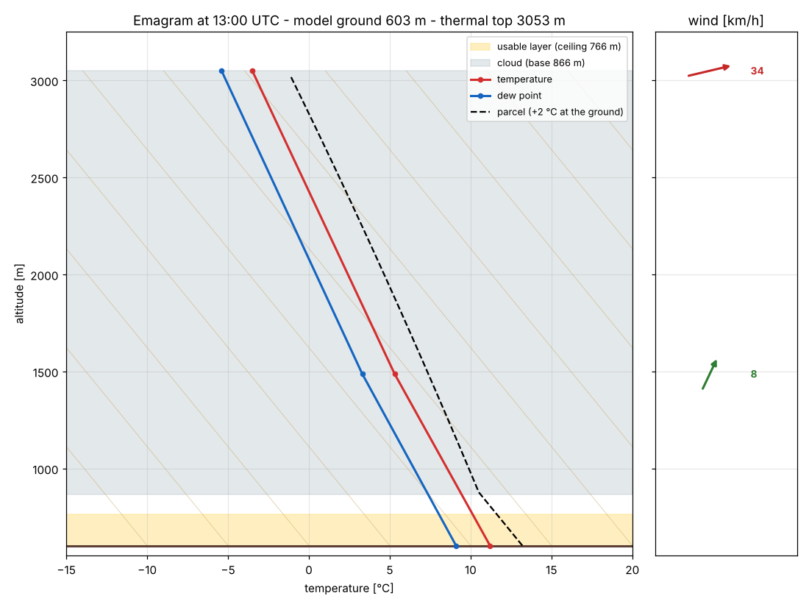
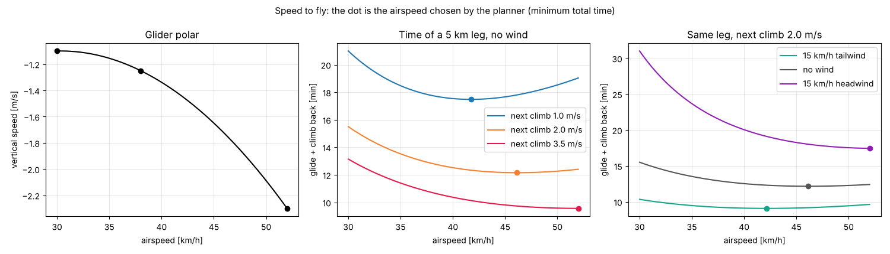
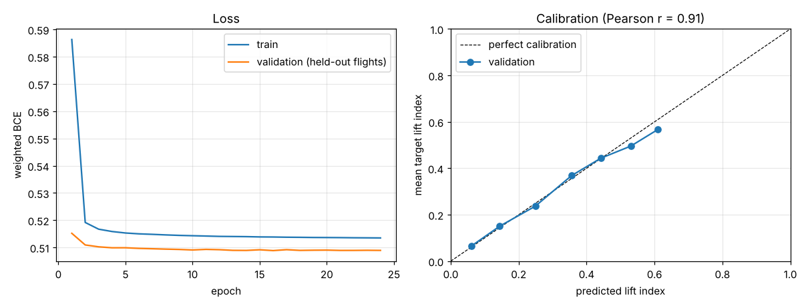
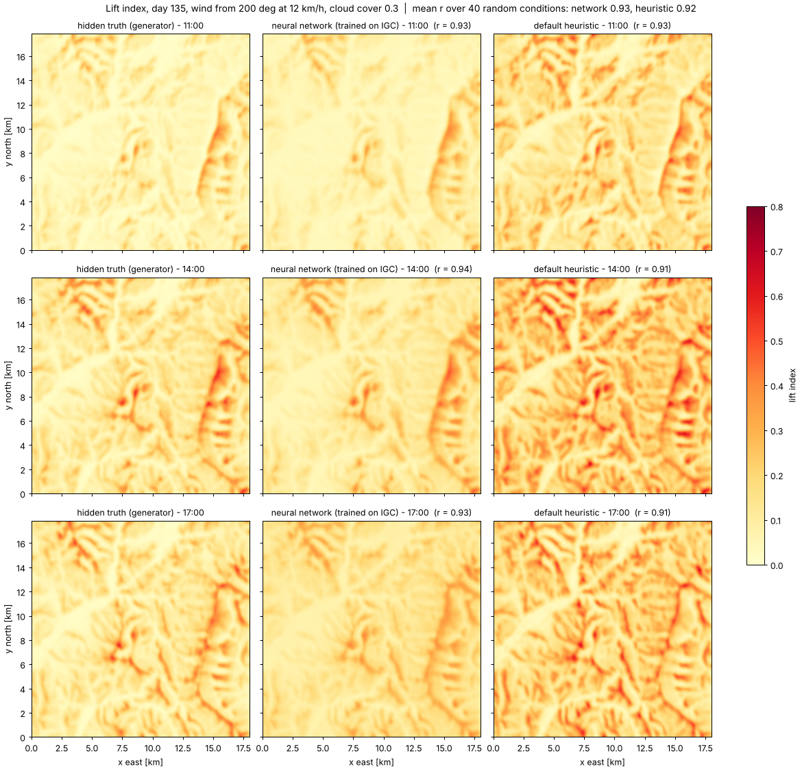

# Model

This document describes what the code computes: the weather of the day, the lift index (analytical or learnt
from IGC tracks), then route optimisation. Every symbol is defined before it is used.

## 1. Frame and notation

| Symbol | Meaning | Unit |
|---|---|---|
| $x, y$ | position in the local frame of the DEM ($x$ east, $y$ north, origin at the south-west corner) | m |
| $z(x, y)$ | terrain altitude | m |
| $t$ | time; local time for the user, solar time ($\text{UTC} + \text{longitude}/15$) inside the weather model | h |
| $j$ | day of year (1 to 365) | – |
| $\mathbf{n}$ | unit normal of the terrain, components (east, north, up) | – |
| $\mathbf{s}(j, t)$ | unit vector pointing at the sun | – |
| $L(x, y, t)$ | **lift index**, dimensionless, in $[0, 1]$ | – |
| $w_{ref}$ | vertical air speed that corresponds to $L = 1$ (5 m/s, `Params.w_ref_ms`) | m/s |
| $H(t)$ | usable ceiling: the highest altitude a climb can reach | m |
| $\mathbf{W}(a, t)$ | synoptic wind at altitude $a$ (horizontal vector, pointing where the air goes) | m/s |

The lift index is the central quantity. Every lift model in the repository produces it, with the same physical
meaning: the vertical speed of the air in the thermal is $w_{ref} \cdot L$.

## 2. Weather (`weather/model.py`)

A `Weather` object describes the day. Scalar values describe the heart of the afternoon; hourly series
(`hourly`) can replace them.

**Wind.** Two levels are given: a low-level wind at altitude $a_1$ (1000 m by default) and a wind aloft at $a_2$
(3000 m). The wind $\mathbf{W}(a, t)$ is the linear interpolation of the two vectors between $a_1$ and $a_2$, and
constant outside.

**Breeze.** Let $\mathbf{u}(x, y)$ be the "uphill direction" field: gradient of the terrain smoothed over 500 m,
normalised, of length 0 on flat ground and 1 as soon as the slope exceeds 10 %. Let $b(t)$ be the breeze
strength, zero at night and maximal around 14:00 solar time (`breeze_kmh`). The local wind near the ground,
written $\mathbf{W}_{gnd}$, is:

$$\mathbf{W}_{gnd}(x, y, t) = \mathbf{W}(z(x, y), t) + b(t)\,\mathbf{u}(x, y)$$

**Cloud base and ceiling.** Let $T$ be the afternoon temperature and $T_d$ the dew point at the reference station
of altitude $z_s$. The cloud base, written $B(t)$, follows the 125 m per degree of spread rule, with a growth
factor $g(t)$ equal to 0.75 at 09:00 solar time and 1 from 15:00:

$$B(t) = z_s + 125\,(T - T_d)\,g(t)$$

The usable ceiling is capped by the cloud base (minus a 100 m margin) and by the inversion altitude
$z_{inv}$, top of the convective layer:

$$H(t) = \min\big(B(t) - 100,\ z_{inv}\big)$$

**Cloud cover.** Let $N \in [0, 1]$ be the fraction of covered sky. The share of clear-sky radiation that reaches
the ground, written $r$, follows the Kasten and Czeplak formula: $r = 1 - 0.75\,N^{3.4}$.

**Other parameters.** `thermal_strength` (written $\sigma$) multiplies the lift index; `snow_line_m` almost
cancels thermals above the snow line; `cast_shadows` turns on shadows cast by the terrain; `overdev_hour` brings
the end of flying forward (overdevelopment).

### 2.1 Vertical profile and emagram (`weather/sounding.py`)

A forecast model such as AROME gives, hour by hour and above one point, the temperature $T_e(a)$ and the dew
point of the ambient air at several altitudes $a$, plus the wind. The ceiling follows from the parcel method,
the one applied by hand on an emagram:

1. A parcel of air leaves the ground (altitude $z_s$) at the 2 m temperature plus an excess $\delta = 2$ °C,
   which stands for the overheating in contact with sunny ground.
2. It rises and cools by 9.8 °C per km (dry adiabat) up to the cloud base $B = z_s + 125\,(T - T_d)$, then more
   slowly above it (moist adiabat, about 5 to 6 °C per km). Its temperature at altitude $a$ is written $T_p(a)$.
3. The top of the thermals, written $a_{top}$, is the first altitude where the parcel is no longer warmer than
   the ambient air: $T_p(a_{top}) \le T_e(a_{top})$.

The usable ceiling and the instability are then:

$$H = \min(a_{top},\ B - 100), \qquad \sigma = \mathrm{clip}\Big(\big(\tfrac{\min(a_{top},\,B) - z_s}{1500}\big)^{1/3},\ 0.3,\ 1.3\Big)$$

The formula for $\sigma$ reflects that thermal strength grows like the cube root of the depth of the dry
convective layer; the scale (1500 m for $\sigma = 1$) is a choice to be calibrated. The wind of the profile
replaces the two levels of § 2: $\mathbf{W}(a, t)$ is interpolated between all available levels.

How to read the figure (real forecast, Digne-les-Bains, 15 November 2026, 13:00 UTC): temperature in red, dew
point in blue, parcel dotted. The temperature / dew point spread at the ground is small (2 °C): the cloud base
is at 870 m, 270 m above the model ground. The yellow band is the only usable layer.

**Forecast.** `weather/openmeteo.py` queries Open-Meteo (Météo-France models) and converts the answer into a
`Sounding`, then a `Weather`: hourly ceiling and instability from the method above, wind profile, cloud cover.
Without pressure levels in the answer, the ceiling falls back on the temperature / dew point spread capped by
the boundary layer height, and the instability on CAPE (a rough mapping).

## 3. Analytical lift model (`lift/heuristic.py`)

With $\tau$ the ground heating delay (1 h by default):

$$L = \mathrm{clip}\Big(\sigma \cdot \mathrm{smooth}\big[\, I(t - \tau)\cdot r \cdot o \cdot f_s \cdot f_r \cdot f_w \cdot f_n \,\big],\ 0,\ 1\Big)$$

- $I(t) = \max(0, \mathbf{n}\cdot\mathbf{s}(j, t))$: sunshine on the slope (east faces in the morning, west faces
  in the afternoon).
- $r$: attenuation by clouds; $o \in \{0, 1\}$: cast shadow (1 when the cell sees the sun).
- $f_s$: slope factor, highest between 15° and 45°.
- $f_r$: relief factor, close to 1 on ridges and upper slopes, close to 0 at the bottom of valleys.
- $f_w$: wind factor, computed with the local wind $\mathbf{W}_{gnd}$: a bonus when it blows onto the slope
  ($-\mathbf{n}\cdot\mathbf{W}_{gnd} > 0$), a penalty in the lee, and an overall degradation as its speed nears
  35 km/h.
- $f_n$: 0.15 above the snow line, 1 elsewhere.

## 4. Learnt model (`lift/neural.py`, `training/`)

### 4.1 Target

An IGC flight gives the position and altitude of the pilot. The vertical speed **of the air** follows:
$w_{air} = w_{pilot} + w_{sink}$, where $w_{pilot}$ is the measured vertical speed of the glider (averaged over
20 s) and $w_{sink}$ its sink rate in still air (1.25 m/s). The training target, written $y$, is:

$$y = \mathrm{clip}\!\left(\frac{w_{air}}{w_{ref}},\ 0,\ 1\right)$$

that is, directly a lift index.

### 4.2 Samples taken from a flight (`training/dataset.py`)

| Kind | Where | Target $y$ | Weight |
|---|---|---|---|
| Thermal | **entry** point of the thermal, once per minute of climb | mean climb rate + $w_{sink}$ | 1 |
| Low glide | under the pilot, when 30 to 400 m above the ground | instantaneous $w_{air}$ | 1 |
| Background | random point of the DEM, random time of the flight | 0 | 0.03 |

- A **thermal** is a phase where the smoothed vertical speed exceeds 0.5 m/s for at least 60 s, with at least
  50 m of gain and a ground track that turns (at least 3°/s on average). A straight climb in rising air is not
  a thermal: it counts as a low glide.
- The thermal is attributed to its entry point, because the column drifts with the wind during the climb.
- **Flight weather**: read from `flight.weather.json` when it exists; otherwise the wind is estimated from the
  drift of the thermals, the ceiling from the highest altitude reached, and the rest is left at defaults.
  `cheminee fetch-weather` creates the file from forecast archives, at three points of the flight
  (`igc/sites.py`): the three fixes forming the largest triangle (the turnpoints of a triangle flight), or, when
  that triangle is flat (area below 10 % of the equilateral triangle of the same perimeter), the takeoff, the
  farthest fix and the fix closest to the middle of the two. Each sample takes the weather of the **nearest**
  point. Positions are rounded to 0.02° before the request.

### 4.3 Input features (`lift/features.py`)

21 features per sample, computed the same way for training and inference:

| Group | Features |
|---|---|
| Terrain (7) | altitude, slope, east and north components of the normal, topographic position, components of $\mathbf{u}$ (breeze direction) |
| Sun (4) | sunshine $\mathbf{n}\cdot\mathbf{s}$ at $t$, $t - 1$ h and $t - 2$ h; sine of the sun elevation |
| Wind (2) | exposure to the local wind $-\mathbf{n}\cdot\mathbf{W}_{gnd}$; speed of $\mathbf{W}_{gnd}$ |
| Weather (4) | lost radiation $1 - r$, instability $\sigma$, ceiling height above the ground, snow-covered ground (0/1) |
| Calendar (4) | sine and cosine of the day of year; sine and cosine of the solar hour |

### 4.4 Network and training (`training/train.py`)

Multilayer perceptron 21 → 64 → 64 → 32 → 1, SiLU activations, sigmoid output (7,681 parameters). Standardised
inputs, weighted binary cross-entropy with continuous targets, AdamW, early stopping. 15 % of the **flights**
(not of the points) are held out for validation.

## 5. Planner (`planning/planner.py`)

### 5.1 Nodes and hourly slots

Thermal nodes are the local maxima of $\max_t L$, at least 1.2 km apart (70 nodes). The climb rate at node $k$
at time $t$, written $c_k(t)$, is:

$$c_k(t) = w_{ref}\,L_k(t) - w_{circ}$$

where $w_{circ}$ is the sink rate of the glider while circling (1.3 m/s). A node is usable when
$c_k \ge 0.5$ m/s. The day is cut into one-hour slots; within a slot the ceiling $H$ and the glide wind (taken
half-way between the ceiling and the nodes) are constant.

**Weather at several points** (`Params.weather_points`, `weather/points.py`). With a forecast the weather is
taken at $K = 3$ points $P_k$: the takeoff and two points forming a triangle with it (`planning/sites.py`).
Between them it is blended with smooth inverse-distance weights

$$\omega_k(x) = \frac{1 / (d_k(x)^2 + L^2)}{\sum_m 1 / (d_m(x)^2 + L^2)}, \qquad L = 2 \text{ km},$$

so that each point rules around it and the weights sum to 1. Then:
- the lift field is $\sum_k \omega_k\, L^{(k)}(x, t)$, where $L^{(k)}$ is the lift model under the weather of
  point $k$ (`lift/points.py`, for any lift model);
- node $i$ climbs to its own ceiling $H_i = \sum_k \omega_k(x_i)\, H^{(k)}$; along a glide the ceiling goes
  linearly from $H_i$ to $H_j$;
- the wind of a glide is blended at the middle of the leg;
- the leg cost climbs back in $j$ up to $H_j$: $\max(0,\ \text{loss} + H_j - H_i) / c_j$;
- a storm at any point ends the day for all.

With a single weather the weights are all 1 and nothing changes.

### 5.2 Speed to fly on a glide

For a leg of length $d$ from node $a$ to node $b$, write $v$ the airspeed, $s(v)$ the sink rate given by the
polar (a parabola through three points: minimum sink, trim speed, full speed bar) and $v_{gnd}(v)$ the ground
speed along the leg, from the wind triangle with the wind of the slot. The total time of the leg, written
$\Delta t$, adds the glide and the climb, at node $b$, back to the height lost:

$$\Delta t(v) = \frac{d}{v_{gnd}(v)} + \frac{1}{c_b}\cdot\frac{d\,s(v)}{v_{gnd}(v)}$$

The planner keeps the speed $v$ that minimises $\Delta t$ among ten speeds of the polar, under two constraints:
keep 60 m of clearance above the terrain along the whole glide (started at the ceiling), and arrive at least
120 m above $b$. This is MacCready's reasoning: fly faster when the next thermal is strong, and into the wind.
The mean speed of the flight is therefore no longer a parameter: it is a result.

**Rising air on the glide.** The glide is followed at 63 points. Where the lift field is above the usable
threshold ($L \ge L_{min}$: a working ridge, a line of thermals) the air rises at
$w = \eta\, w_{ref}\, L$, with $\eta$ = `glide_lift_efficiency` (0.5: flying straight, the glider meets about
half the speed of a thermal core), and the pilot slows down to minimum sink, as MacCready says to do in rising
air. Elsewhere the air is taken as still and the glide is flown at $v$. The height lost from the start to each
point, and the time, are summed point by point; the altitude can go up where $w$ exceeds the minimum sink, never
above the ceiling: $h_s = h_0 - \delta_s - \max(0,\ h_0 - H - \min_{u \le s} \delta_u)$, with $\delta_s$ the
height lost up to point $s$. Clearance and arrival margin are checked on that curve, and the 3D track shows it.
`--glide-lift 0` gives still air on every glide.

**Climbing like a pilot.** The search climbs back to the ceiling in every thermal: it keeps the graph small
(one state per node and time) and gives each leg the MacCready cost above. Once a route is chosen, its climbs
are shared out along it (`Params.partial_climbs`, on by default), with the greedy rule of the "gas station
problem": altitude is fuel and a metre climbed at node $k$ costs $1 / c_k$ seconds.

- In a thermal, if a stronger thermal further on, or the goal, can be reached without climbing above the
  ceiling, the pilot climbs just enough to reach it; otherwise they climb to the ceiling.
- A thermal not worth circling is crossed in a straight line, with the rising air it gives on the way (see
  above): dolphin flying.
- A thermal reached before it works (the day is still building), or before the cloud base is high enough for
  the next glide, is waited for, hanging on in weak lift.
- The last climb stops at the height the final glide needs, and the flight ends on arrival.

Every departure height respects the terrain clearance along the whole glide (on its real altitude curve,
rising air included) and the arrival margin. The rule is
optimal for climb rates that do not change with time; the timeline is then recomputed with the rates of the
actual arrival times, and the full-climb plan is kept if the shared one is not faster. The search also keeps 3
neighbours per azimuth sector (`Params.neighbours_per_sector`), so that long glides skipping weak thermals are
available to it.

### 5.3 Free distance

Search in 5-minute steps: at each (node, time) the 3 best route beginnings are kept, in the sense of free
distance over 3 turnpoints (start, 3 points, end, taken in track order). The pilot may wait at takeoff; they
leave by climbing in the takeoff thermal, or otherwise by gliding straight to a nearby thermal.

## 6. Optimiser (`planning/optimizer.py`)

**Fastest paths.** `earliest(source, t)` is a time-dependent Dijkstra algorithm: it gives the earliest arrival
time at every node when leaving `source` at time $t$, leg durations being those of § 5.2 at the departure time
of each leg.

**Triangles.** For three nodes $P_1, P_2, P_3$, write $p$ the perimeter. The triangle is FAI when its shortest
side is at least 28 % of $p$. The optimiser:

1. lists every ordered triple of reachable nodes and sorts them by decreasing points
   (points $= p \times$ the coefficient of the kind);
2. for each triple, chains the fastest paths takeoff → $P_1$ → $P_2$ → $P_3$ → closing point, the latter being
   the first node reached within 5 % of $p$ from the takeoff or from $P_1$;
3. keeps the triple if the whole flight fits before the deadline, then tries its five other orders and keeps the
   one that lands first.

Since triples are examined by decreasing points, the first feasible triangle is the best over all nodes (within
the model). The following ones must differ by at least two vertices.

**Goal.** `to_goal(x, y)` returns the fastest path to the reachable node closest to the goal.

**`score` objective.** Merges free distance and triangles, ranked by points, with a diversity constraint (less
than 50 % of nodes in common).

### Scoring rules

The three route kinds and coefficients follow the French CFD rules (adjustable in `Params`):

| `--objective` | Route | Counted distance | Coefficient |
|---|---|---|---|
| `triangle` (default) | triangle through 3 turnpoints B1, B2, B3, closed within 5 % | perimeter | 1.2 (flat) or 1.4 (FAI) |
| `fai` | same, with the shortest side ≥ 28 % of the perimeter | perimeter | 1.4 |
| `free` | free distance via 3 turnpoints (4 legs, open) | sum of the 4 legs | 1.0 |
| `score` | the three kinds ranked together by points | | |

## 7. Results on synthetic data

Without real tracks, the pipeline is tested as follows: `igc/synthetic.py` simulates flights over a **hidden**
lift model, purposely different from the default analytical model (1.7 h heating delay, shifted optimal slope,
more wind-sensitive, seasonal effect, favourable altitude band), under weather drawn at random for each flight
(wind at both levels, temperature / dew point spread, inversion, cloud cover, instability, breeze). The network
only sees the IGC files and their weather files.

On 300 simulated flights (40,774 samples):

| Measure | Value |
|---|---|
| Prediction / target correlation on validation flights | 0.91 |
| Weighted mean absolute error on validation | 0.04 |
| Correlation with the hidden field, 40 random conditions — network | 0.93 on average (minimum 0.73) |
| Correlation with the hidden field, same conditions — default analytical model | 0.92 on average (minimum 0.82) |

Response to the weather: mean index of the 5 % best cells at 14:30, one parameter changed at a time.

| Situation | Hidden field | Network | Analytical model |
|---|---|---|---|
| Reference | 0.39 | 0.39 | 0.48 |
| Cloud cover 0.7 | 0.30 | 0.31 | 0.38 |
| Instability 0.75 | 0.29 | 0.31 | 0.36 |
| Wind 20 km/h | 0.24 | 0.26 | 0.33 |

What these numbers say:

- From tracks alone, the network recovers the spatial structure of the hidden field, its amplitude, and its
  sensitivity to cloud cover, instability and wind.
- In spatial correlation it is on par with the analytical model, not above it, and its worst case is worse.
  This is expected: the analytical model belongs to the same family of formulas as the generator.
- These results validate the software pipeline. They say **nothing** about the ability of the network to
  predict real thermals: that can only be measured on real tracks.

## 8. Ideas

- Train on real tracks, with the weather of each flight taken from a reanalysis.
- Land cover (forest, rock, meadow) as terrain features.
- Horizontally varying wind at a finer scale than the three weather points (valley channelling, convergence).
- Weather points that follow the route being searched, or a regular grid of forecasts over the map.
- Airspace and landing fields as optimiser constraints.
- Altitude as a state of the search itself (the climbs are only shared out after the search today), and
  climb rates that weaken near the top of the thermal.
- Free distance: end with a glide beyond the last thermal, to the farthest reachable point.
